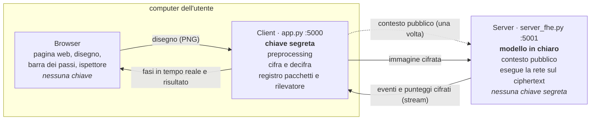
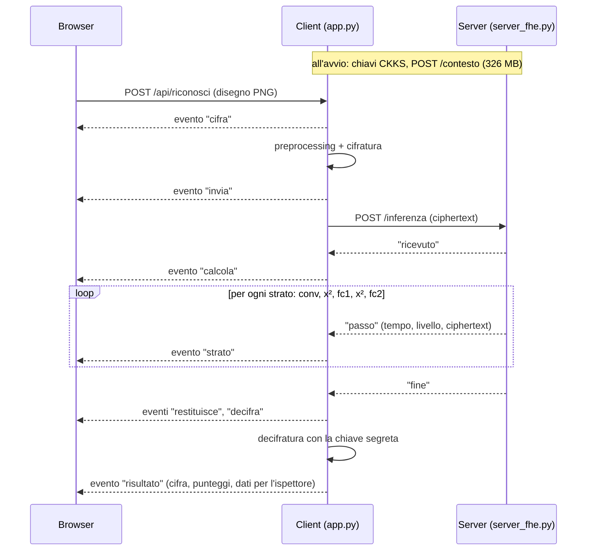

# Architettura

[← Indice](../README.md)

Il sistema è fatto di **due processi distinti** che comunicano solo via HTTP, più
la pagina web nel browser. Il client tiene la chiave segreta; il server tiene il
modello e calcola senza poter decifrare nulla.

## I componenti

| componente | file | possiede | fa |
|---|---|---|---|
| Browser | `static/` | niente di segreto | raccoglie il disegno, mostra le fasi e l'ispettore |
| Client | `app.py`, `fhe.Client`, `rete.py` | chiave segreta | prepara e cifra l'immagine, decifra i punteggi, registra e analizza i pacchetti |
| Server | `server_fhe.py`, `fhe.Server` | modello addestrato, contesto pubblico | esegue conv → x² → fc1 → x² → fc2 sul ciphertext |

TenSEAL non funziona nel browser, quindi il client è un processo Python. Il
disegno passa dal browser al client **sullo stesso computer**; al server arrivano
solo il contesto pubblico e i ciphertext. `app.py` avvia `server_fhe.py` da solo
se sulla porta 5001 non risponde già un server.

## Cosa viaggia tra client e server

| messaggio | direzione | dimensione | quando |
|---|---|---|---|
| Contesto pubblico: parametri, chiave pubblica, chiavi di rilinearizzazione e di Galois | client → server | 326 MB | una volta per sessione |
| Immagine cifrata (CKKSVector serializzato) + numero di finestre | client → server | 1,4 MB | a ogni cifra |
| Eventi di avanzamento, ciphertext intermedi, punteggi cifrati | server → client | ~6,7 MB in stream | a ogni cifra |
| Pesi del modello (solo per la vista didattica) | server → client | 358 kB | una volta per sessione |

Il numero di finestre (64) viaggia in chiaro: dipende solo dalla forma 28×28
dell'input, non dal contenuto. I ciphertext intermedi servono solo
all'[ispettore](ispettore.md); in un sistema reale il server restituirebbe solo i
punteggi (262 kB).

## Flusso di una richiesta

Entrambe le risposte sono in streaming (una riga JSON per evento), così la barra
dei passi della demo avanza solo quando una fase avviene davvero. Dettagli in
[API](api.md).
