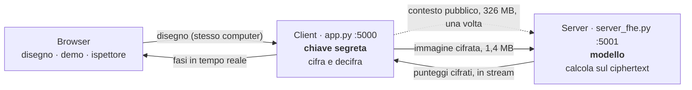

# Riconoscere cifre scritte a mano senza guardarle

Progetto didattico: una rete neurale riconosce le cifre del dataset **MNIST**
lavorando su immagini **cifrate con crittografia omomorfica** (schema CKKS,
libreria [TenSEAL](https://github.com/OpenMined/TenSEAL)).

Il server esegue tutta la rete sull'immagine cifrata e restituisce un risultato
cifrato. Solo il client, che possiede la chiave segreta, può leggere quale cifra
è stata riconosciuta. Una demo web mostra ogni passaggio, permette di ispezionarne
i dati reali e verifica pacchetto per pacchetto che l'immagine non lasci mai il
client.



## Risultati

| misura | valore |
|---|---|
| Accuratezza in chiaro (10.000 immagini di test) | 97,77% |
| Accuratezza cifrata (100 immagini di test) | 100%, predizioni identiche al modello in chiaro |
| Scarto massimo tra punteggi cifrati e in chiaro | circa 2 × 10⁻³ |
| Tempo per una cifra (cifratura + calcolo + decifratura) | circa 4 s su CPU |
| Sicurezza dello schema | 128 bit |
| Immagine trovata nei pacchetti client ↔ server | mai |

## Avvio rapido

Serve Python 3.11 (testato su Windows 11).

```bash
pip install -r requirements.txt
python addestra.py              # scarica MNIST, addestra in chiaro, salva modello.pt (~1 min)
python valuta_cifrato.py 100    # confronta inferenza cifrata e in chiaro su 100 immagini
python app.py                   # demo su http://127.0.0.1:5000
```

`app.py` avvia da solo il processo server (`server_fhe.py`, porta 5001). All'avvio
il client genera le chiavi e invia il contesto pubblico (~15 s, una volta sola);
poi ogni cifra richiede ~4 s.

Nella demo: disegna una cifra e premi **Riconosci** (o `Invio`). **Esempio** (`E`)
carica una cifra del test set, **Ispeziona** (`I`) apre i dettagli di ogni fase.

## Struttura del repository

```
├── addestra.py          training in chiaro (PyTorch) → modello.pt
├── app.py               processo CLIENT + demo web (Flask, porta 5000)
├── dati_mnist.py        download e lettura di MNIST, normalizzazione
├── fhe.py               classi Client e Server (TenSEAL / CKKS)
├── modello.py           la rete ReteCifrabile
├── rete.py              registro dei pacchetti e rilevatore dell'immagine
├── server_fhe.py        processo SERVER (porta 5001)
├── valuta_cifrato.py    accuratezza cifrata contro quella in chiaro
├── requirements.txt
├── static/              pagina web: index.html, style.css, app.js, ispettore.js, ispettore.css
└── docs/                documentazione
```

`dati/` (MNIST) viene creata da `addestra.py`; `modello.pt` contiene i pesi addestrati.

## Documentazione

| documento | contenuto |
|---|---|
| [Architettura](docs/architettura.md) | i due processi, cosa viaggia tra loro, flusso di una richiesta |
| [Modello e training](docs/modello-e-training.md) | la rete, i dati, il training in chiaro e i risultati |
| [Inferenza cifrata](docs/inferenza-cifrata.md) | parametri CKKS, codifica im2col, bias inglobato, livelli |
| [Demo web](docs/demo-web.md) | la vista principale, la barra dei passi, i tasti |
| [Ispettore](docs/ispettore.md) | le 13 pagine di dettaglio, una per fase |
| [Verifica di rete](docs/verifica-di-rete.md) | registro dei pacchetti, rilevatore, conferma SHA-256 |
| [API](docs/api.md) | endpoint HTTP del server e del client, formato degli eventi |
| [Decisioni e problemi risolti](docs/decisioni.md) | le scelte progettuali e perché |
| [Limiti e sviluppi](docs/limiti.md) | cosa non fa e come si potrebbe estendere |

## Perché training in chiaro e inferenza cifrata

| fase | dove avviene | perché |
|---|---|---|
| Training | in chiaro, con PyTorch | veloce, 97,8% di accuratezza sul test set |
| Inferenza | sui dati cifrati, con TenSEAL | il server non vede né l'immagine né il risultato |

Il training cifrato di reti neurali è ancora materia di ricerca: le librerie
pronte supportano solo modelli semplici come la regressione logistica. Per questo
il progetto addestra in chiaro e cifra solo l'inferenza, lo scenario più comune
nella pratica (*Machine Learning as a Service* che rispetta la privacy).

## Riferimenti

- Benaissa et al., *TenSEAL: A Library for Encrypted Tensor Operations Using
  Homomorphic Encryption*, ICLR 2021 Workshop.
  [arXiv:2104.03152](https://arxiv.org/abs/2104.03152)
- Cheon, Kim, Kim, Song, *Homomorphic Encryption for Arithmetic of Approximate
  Numbers* (CKKS), ASIACRYPT 2017.
- Gilad-Bachrach et al., *CryptoNets: Applying Neural Networks to Encrypted Data
  with High Throughput and Accuracy*, ICML 2016.
- Halevi, Shoup, *Algorithms in HElib*, CRYPTO 2014: il metodo diagonale usato
  per il prodotto matrice-vettore.
